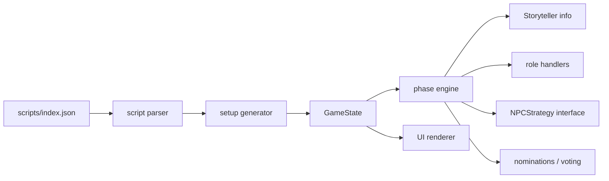

# Solo Clocktower MVP

A dependency-free browser prototype for the supplied Trouble Brewing JSON. It is an unofficial fan implementation: use original UI/artwork and do not redistribute proprietary art or rulebook text.

## Run

```bash
python3 -m http.server 8000
# open http://localhost:8000
```

Do not double-click `index.html`: `fetch()` needs an HTTP origin. To add a script, put its JSON in `scripts/` and add its filename to `scripts/index.json`. Browser pages cannot silently enumerate a server or local folder. Unknown role IDs fail fast because only Trouble Brewing handlers exist.

## Test

```bash
npm test
```

## Architecture



- `data.js`: canonical roster metadata and seat-count table.
- `setup.js`: parsing, legal role counts, Baron/Drunk, non-Demon good human, bluffs.
- `storyteller.js`: registrations and derived information; Storyteller choices are seeded and cached.
- `strategies.js`: replaceable NPC talk/vote/target policy.
- `engine.js`: nights, deaths, succession, nominations, votes, wins.
- `app.js`: browser adapter only.

## Deliberate solo rules

1. The human is always good and cannot be the Imp. The Demon, Mayor redirects and Poisoner never target the human. The UI has no NPC nominations, so the human reaches final three.
2. If the human Townsfolk nominates an NPC Virgin, the Virgin is confirmed and the day ends, but plot armour cancels the human's canonical death.
3. One human nomination is resolved per day; this omits competing nominations and ties. Majority is `ceil(living/2)`.
4. Evil NPCs never vote for an evil nominee. Good votes use a configurable probabilistic heuristic. These are requested solo rules, not canonical strategy.
5. Poison affects NPCs; it never selects the human. The actual Drunk is implemented: that player sees an unused Townsfolk and receives plausible but unreliable output.
6. Recluse/Spy registrations and Mayor redirection are seeded Storyteller choices. Replaying a seed reproduces the setup and choices.
7. Evil claims use out-of-play good bluffs at every seat count for playability, although canonical first-night evil information differs in 5–6-player games.
8. Dead NPC ghost votes are included once, but the MVP does not model free-form NPC nominations, multiple nominations, or public discussion.

## Extension points

Replace `SimpleNpcStrategy` with a class exposing `ask`, `vote`, `choosePoison`, `chooseMonk`, `chooseButler`, `chooseDemonTarget`, and `chooseRaven`. A smarter implementation can receive an immutable public projection plus private knowledge, and maintain per-NPC beliefs, claims, trust, contradictions and plans. Move poison/drunk distortion behind an `InformationPolicy` if adding richer Storyteller controls.
